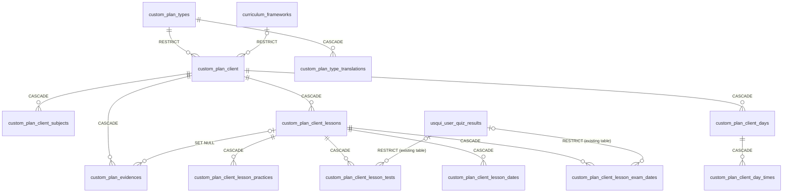
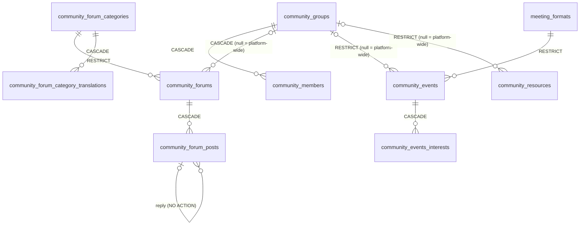

# Custom Plans & Community — database structure

Database: **gs_web_api_db** (`ConnectionStrings:GSWebDBConnection`), MySQL 8.0.46.
Migration: `20261106194343_AddCustomPlansAndCommunity` (EF Core 9 + Pomelo). It creates 21 tables and
touches no existing table. The only link to an existing table is the FK to `usqui_user_quiz_results`.
Items marked 🆕 are from the latest round of feedback: the quiz submit endpoint now updates the student's custom plan, and practices/exams can be added to a running plan so a lesson never gets stuck. No table changed in this round.

**Status:** implemented and tested (152 tests on a real MySQL 8.0.46 container). Not yet applied to any shared
database, permissions script not yet run, nothing committed since the "Homeschooling module" commit.

## What was requested

| Request | Where it stands |
|---|---|
| Custom Plans and Community modules with EF Core (Pomelo), all code in GSWebAPI | Done: 21 tables, services, controllers |
| Explicit MySQL version, connection string from the DAO config, no new secrets | `MySqlServerVersion(8.0.46)`, `ConnectionStrings:GSWebDBConnection` |
| One `IEntityTypeConfiguration<T>` per entity, unsigned keys, UTC dates, native snake_case ENUMs | Done (see conventions below) |
| Audit columns by interceptor, soft delete by global query filter | Done |
| CHECKs, unique keys, indexes and delete rules from the spec; catalogs seeded with `HasData` | Done |
| Never create/alter/drop existing tables (`ExcludeFromMigrations`) | Only `usqui_user_quiz_results` is mapped, excluded from migrations |
| Leave existing DAOs untouched; no new DAOs | Untouched |
| Students come from `ul_user_accounts`; names fetched like other APIs do | Names via `usersapi/users/fullnames`; student ownership via `usersapi/profiles` |
| `gwp_user_result_id` → `usqui_user_quiz_results` | Real FK (signed INT to match) |
| Framework: Puerto Rico for now | DEPR seeded; only DEPR accepts standards |
| References to other databases as logical FKs | Indexed columns, no FK constraint |
| Tests on real MySQL (no in-memory provider) | xUnit + Testcontainers `mysql:8.0.46` |
| Permissions for the client role only | Script: `GSWebAPI/DatabaseScripts/20261105_users_db_permissions_custom_plans_community.sql` |
| **Change:** community forums independent of TeachersAPI; undo the Teachers forum changes | Done: own forum, category and post tables in GSWebAPI. TeachersAPI back to its previous code |
| **Change:** learning part (concept, definitions, examples) gets one assigned date + due date + time zone | `custom_plan_client_lessons.learning_assigned_date / learning_due_date / learning_timezone` |
| **Change:** exams get a due date **with time**, a time zone and a duration | `custom_plan_client_lesson_exam_dates.due_date_time / timezone / duration_minutes` |
| **Change:** validation logic for the plan schedule | Rules and error codes in section 3 |
| **Change:** no foul words in forums, English and Spanish | `ProfanityFilter`, section 3 |
| **Change:** one endpoint to read the plans of a parent's children, filtered by children, dates and scores | `GET gswebapi/custom-plans/overview`, section 4 |
| **Change:** practices finished and due dates (and anything else needed to read the plans) | `subject_id` and `learning_completed_at` on lessons, `completed_at` on exams (practices: see the next change) |
| **Change:** several practices per lesson (the ones the lesson has in Athenas, no fixed minimum), each with its own assigned/due date, quiz id, status, score and time zone | New table `custom_plan_client_lesson_practices`; the single practices window was removed from lessons |
| **Change:** practices treated like exams (due date-time, time zone, status), no duration, score not in `usqui_user_quiz_results` | `custom_plan_client_lesson_practices`: `due_date_time`, `score`, `best_score`, `attempts`… (no FK to usqui) |
| **Change:** no minimum of practices; the lesson's quizzes in Athenas are the reference | Practice, exam and test ids are checked against the lesson's quizzes in Athenas |
| **Change:** a lesson can be completed only when its practices and exams are completed, compared with Athenas | Checked when `lessonStatus = completed` is sent |
| **Change:** pre-test and post-test in a separate table | New table `custom_plan_client_lesson_tests` (both optional) |
| 🆕 **Change:** a lesson must never get stuck when Athenas adds a quiz after the plan started | `POST /{planId}/lessons/{planLessonId}/activities` adds practices, exams or tests to a running plan; the overview lists what is missing |
| 🆕 **Change:** the quiz correction endpoint evaluates the student's custom plan (only students with one) | `POST gswebapi/quiz/student/submit/` calls `CustomPlanQuizEvaluator` after its normal process |
| 🆕 **Change:** `pre_completed`, `test_completed`, `post_completed` set from the quizzes | Kept by the service from the plan's tests and exams (section 3) |
| **Change:** evidences and projects (URL, title, description), files in Blob Storage | New table `custom_plan_evidences`; upload reuses GSWebAPI's `AzureAssets` |

## Step by step: from this branch to a working environment

Commands run from the repository root (`gs-base-api`). Do the steps in order, one environment at a time (dev → UAT → production). Steps 1–3 don't touch any database.

### 0. What you need
- **.NET 8 SDK**, plus the `dotnet-ef` tool pinned in `dotnet-tools.json` (9.0.10).
- **Docker Desktop running**, only for the tests (they start a `mysql:8.0.46` container).
- **A MySQL client** (Workbench or `mysql` CLI) with a user that can `CREATE`, `ALTER`, `INDEX` and `REFERENCES` on `gs_web_api_db`, and `INSERT` on the users DB (for the permissions).
- **The connection strings** of the target environment: `ConnectionStrings:GSWebDBConnection` (GS Web) and `ConnectionStrings:GenialSkillsUsersAPIDBConnection` (users DB).

### 1. Restore the tools and build
```bash
dotnet tool restore
dotnet build GSBaseAPI/GSBaseAPI.sln
```
Expected: `Build succeeded` with 0 errors.

### 2. Run the tests (real MySQL in Docker)
```bash
dotnet test GSWebAPI.Tests
```
Expected: `Passed! - Failed: 0`. This applies the migration to an empty copy of the existing tables. It also runs the sample data script and its queries.

### 3. Generate and review the migration SQL
Generating the scripts doesn't connect to any server.
```bash
# Plain script: what the migration does, to read and review
dotnet ef migrations script --project GSWebAPI/GSWebAPI.csproj --context GSWebDbContext -o AddCustomPlansAndCommunity.plain.sql

# Idempotent script: safe to run on a server (skips what was already applied); use this one in step 6
dotnet ef migrations script --idempotent --project GSWebAPI/GSWebAPI.csproj --context GSWebDbContext -o AddCustomPlansAndCommunity.sql

# Rollback script (only drops the new tables), keep it next to the other two
dotnet ef migrations script AddCustomPlansAndCommunity 0 --project GSWebAPI/GSWebAPI.csproj --context GSWebDbContext -o AddCustomPlansAndCommunity.rollback.sql
```
What to check in the plain script:
- 21 `CREATE TABLE` (plus `__EFMigrationsHistory` if the database never had one);
- no `ALTER DATABASE` and no `DROP TABLE`;
- no `ALTER TABLE usqui_user_quiz_results`. The only reference to it is the 3 FKs (`FK_cpc_lesson_exam_dates_…`, `FK_cpc_lesson_tests_…`, and their indexes).

Keep the generated `.sql` files outside the repository, or delete them after use. They are reproducible.

### 4. Back up the target database
```bash
mysqldump -h <host> -u <user> -p --single-transaction --routines --triggers gs_web_api_db > gs_web_api_db_before_custom_plans.sql
```

### 5. Pre-checks on the target database
```sql
SELECT VERSION();                                                      -- 8.0.x
SHOW CREATE TABLE usqui_user_quiz_results;                             -- exists, `id` int NOT NULL AUTO_INCREMENT
SELECT table_name FROM information_schema.tables
 WHERE table_schema = DATABASE()
   AND (table_name LIKE 'custom\_plan%' OR table_name LIKE 'community\_%'
        OR table_name IN ('meeting_formats', 'curriculum_frameworks'));  -- expect 0 rows (no name clash)
SELECT * FROM __EFMigrationsHistory;                                   -- may not exist yet; that is fine
```

### 6. Apply the migration (choose one way)
**Option A — run the SQL (recommended for UAT and production).** Open `AddCustomPlansAndCommunity.sql` (the idempotent one) in Workbench, connected to the target `gs_web_api_db`, and run it all. Or:
```bash
mysql -h <host> -u <user> -p gs_web_api_db < AddCustomPlansAndCommunity.sql
```

**Option B — `dotnet ef` (handy for local/dev).** The tool reads the connection from the `GSWEB_EF_CONNECTION` environment variable; there is no connection string in the code.
```powershell
# PowerShell
$env:GSWEB_EF_CONNECTION = "Server=<host>;Port=3306;Database=gs_web_api_db;User ID=<user>;Password=<password>"
dotnet ef database update --project GSWebAPI/GSWebAPI.csproj --context GSWebDbContext
Remove-Item Env:GSWEB_EF_CONNECTION
```
```bash
# bash
export GSWEB_EF_CONNECTION="Server=<host>;Port=3306;Database=gs_web_api_db;User ID=<user>;Password=<password>"
dotnet ef database update --project GSWebAPI/GSWebAPI.csproj --context GSWebDbContext
unset GSWEB_EF_CONNECTION
```
The API does **not** apply migrations on startup. A deploy never changes the schema by itself.

### 7. Verify the migration
```sql
SELECT MigrationId, ProductVersion FROM __EFMigrationsHistory;    -- 20261106194343_AddCustomPlansAndCommunity, 9.0.10
SELECT COUNT(*) FROM information_schema.tables
 WHERE table_schema = DATABASE()
   AND (table_name LIKE 'custom\_plan%' OR table_name LIKE 'community\_%'
        OR table_name IN ('meeting_formats', 'curriculum_frameworks'));  -- 21
SELECT * FROM custom_plan_types;            -- 4 rows
SELECT * FROM meeting_formats;              -- 2 rows
SELECT * FROM curriculum_frameworks;        -- 1 row (DEPR)
SELECT * FROM community_forum_categories;   -- 7 rows
SHOW CREATE TABLE usqui_user_quiz_results;  -- same as in step 5 (only new FKs point to it)
```

### 8. Grant the permissions (users database)
Run `GSWebAPI/DatabaseScripts/20261105_users_db_permissions_custom_plans_community.sql` on the **users** database (`GenialSkillsUsersAPIDBConnection`). It is idempotent, and its check query must return **4 rows**. It gives `CustomPlanRead`, `CustomPlanHandler`, `CommunityRead` and `CommunityHandler` to role 1 (client). Users who were already signed in may need to sign in again to get the new permissions.

### 9. Configuration
Nothing new is required. The module uses keys that already exist in all 9 `appsettings*.json` files:
- **Database:** `ConnectionStrings:GSWebDBConnection`.
- **Users API:** `AppSettings:gus_web_service_url`.
- **Athenas:** `athenas_service_url`, `AthenasWebServiceApiAccessKey`, `athenas_api_lessons_models_read`, `athenas_web_api_get_subjects`, `athenas_web_api_get_grades`, `athenas_web_api_get_codes`, `athenas_api_get_lesson_quizzes`.
- **Blob Storage:** `azure_storage_account_name`, `AzureStorageAccountKey`, `azure_storage_container_name_gsweb`.

Check that the `gsweb-api` container exists in the storage account (the existing reports already use it). Optional: `AppSettings:community_blocked_words` (comma-separated) to add words to the foul-language filter.

### 10. Deploy
Deploy `GSBaseAPI` as usual. The modules are registered by `AddGSWebData` in `GSBaseAPI/Program.cs`.

### 11. Smoke test
- **Dev / QA only:** load the sample data and run the reads. Set the variables at the top to test accounts and real Athenas ids if you want to check names and titles through the API.
  ```bash
  mysql -h <host> -u <user> -p gs_web_api_db < GSWebAPI/DatabaseScripts/20261106_sample_data_custom_plans_community.sql
  mysql -h <host> -u <user> -p gs_web_api_db < GSWebAPI/DatabaseScripts/20261106_sample_queries_custom_plans_community.sql
  ```
- **Through the API:** sign in as the client, then call the endpoints listed at the top of the queries file, with the same session headers the front end sends. For example:
  - `GET gswebapi/custom-plans/overview`
  - `GET gswebapi/custom-plans/{planId}`
  - `GET gswebapi/community/groups`
- **Quiz flow:** as a student with an active plan, submit a practice or an exam (`POST gswebapi/quiz/student/submit/`). Then check that the practice or exam is `completed` in the overview. A student without a plan must behave exactly as before.

### 12. Remove the sample data (dev / QA)
Run only the "Remove the previous sample" block of the sample script: the `SET` lines, then the `DELETE` statements, then `COMMIT`. Or run the whole script and then delete the plans and group it creates again. The block only touches sample rows: the plans of `@client_id` for the two sample children, `usqui` rows marked `[SAMPLE] custom plan`, and groups named `[SAMPLE]…`.

### 13. Rollback (if needed)
1. Stop or roll back the API deploy first, so nothing writes to the new tables.
2. Run `AddCustomPlansAndCommunity.rollback.sql` from step 3 on `gs_web_api_db`. It drops only the 21 new tables and removes the history row; existing tables and data are not touched. With Option B instead:
   ```bash
   dotnet ef database update 0 --project GSWebAPI/GSWebAPI.csproj --context GSWebDbContext   # GSWEB_EF_CONNECTION set
   ```
3. Optionally, remove the permissions on the users DB:
   ```sql
   DELETE rp FROM ur_role_permissions rp JOIN ur_permissions p ON p.id = rp.permission_id
    WHERE p.name IN ('CustomPlanRead', 'CustomPlanHandler', 'CommunityRead', 'CommunityHandler');
   DELETE FROM ur_permissions WHERE name IN ('CustomPlanRead', 'CustomPlanHandler', 'CommunityRead', 'CommunityHandler');
   ```
4. If the step 4 backup is needed, restore it with `mysql … gs_web_api_db < gs_web_api_db_before_custom_plans.sql`.

### 14. Commit (when you decide)
Nothing has been committed yet. Before committing:
- the old migration `20261105144112_*` is deleted on purpose; it was replaced by `20261106194343_*`, which was never applied anywhere;
- the 9 `GSBaseAPI/appsettings*.json` files show as modified on purpose. They remove the three TeachersAPI forum keys (`gs_endpoint_community_forum_access`, `teachers_endpoint_forums`, `teachers_endpoint_community_forums_by_ids`) that the "Homeschooling module" commit added, which leaves them as they were before that commit;
- `GSBaseAPI/.vs/…/.dtbcache.v2` is a Visual Studio cache file: don't commit it;
- there are production credentials committed in `appsettings.json`, an existing issue that is worth moving to Key Vault.

## Conventions (apply to every table)

| Topic | Rule |
|---|---|
| Keys | `id BIGINT UNSIGNED AUTO_INCREMENT`; catalogs use `TINYINT`/`SMALLINT UNSIGNED` |
| Charset | `utf8mb4` / `utf8mb4_0900_ai_ci`, set per table (no `ALTER DATABASE`) |
| Audit | `created_at`, `updated_at` `TIMESTAMP DEFAULT CURRENT_TIMESTAMP`, filled by the EF interceptor (UTC) |
| Soft delete | Tables marked 🗑 have `deleted_at TIMESTAMP NULL`. EF hides those rows with a global query filter, and `Remove()` sets `deleted_at` instead of deleting |
| Dates | All `DATETIME`/`TIMESTAMP` values are UTC. Time zones are stored as IANA names (`America/Puerto_Rico`) |
| Enums | Native MySQL `ENUM` with snake_case values |
| Other DBs | Users (`ul_user_accounts`) and Athenas (subjects, levels, lessons, standards, quizzes) live in other databases, so those columns are **logical references**: indexed, no FK constraint. Marked 🔗 below |

---

## 1. Custom Plans



### `custom_plan_client` 🗑 — the plan header
| Column | Type | Notes |
|---|---|---|
| id | bigint unsigned PK | |
| custom_plan_type_id | tinyint unsigned | FK → `custom_plan_types` (RESTRICT) |
| client_id | bigint unsigned | 🔗 `ul_user_accounts.id`, the paying account holder (client role) |
| student_id | bigint unsigned | 🔗 `ul_user_accounts.id`, the student profile (must belong to the client) |
| level_id | bigint unsigned | 🔗 Athenas level |
| curriculum_framework_id | smallint unsigned NULL | FK → `curriculum_frameworks` (RESTRICT) |
| plan_duration_weeks | smallint unsigned | |
| start_date / end_date | date / date NULL | |
| status | enum(`draft`,`active`,`paused`,`completed`,`cancelled`) | default `draft` |
| total_study_minutes | int unsigned | 🆕 default 0. Minutes the student has studied in the plan: the sum of its lessons, kept by the service in the same transaction |

Indexes: `(client_id)`, `(student_id, status)`.
Status flow: draft → active (needs ≥1 lesson) / cancelled · active → paused / completed / cancelled · paused → active / cancelled. The structure (subjects, days, lessons) can only be edited in `draft`.

### `custom_plan_client_subjects`
`custom_plan_client_id` FK (CASCADE), `subject_id` 🔗 Athenas subject. **Unique** `(custom_plan_client_id, subject_id)`.

### `custom_plan_client_days`
`custom_plan_client_id` FK (CASCADE), `day_of_week tinyint` with **CHECK** `BETWEEN 1 AND 7`. **Unique** `(custom_plan_client_id, day_of_week)`.

### `custom_plan_client_day_times`
`custom_plan_client_day_id` FK (CASCADE), `start_time time`, `duration_minutes smallint`, `timezone varchar(64)`. **Unique** `(custom_plan_client_day_id, start_time)`.

### `custom_plan_client_lessons`
| Column | Type | Notes |
|---|---|---|
| custom_plan_client_id | bigint unsigned | FK (CASCADE) |
| lesson_id | bigint unsigned | 🔗 Athenas lesson |
| standard_id | bigint unsigned NULL | 🔗 Athenas standard; must be null when the plan has no framework |
| subject_id | bigint unsigned | 🔗 Athenas subject; must be one of the plan's subjects. Lets the plan be read **by subject** without calling Athenas |
| sequence | smallint unsigned | order within the plan (unique per plan, service rule) |
| learning_assigned_date | date | start of the **learning part** (concept + definitions + examples, one window for the three) |
| learning_due_date | date | last day to finish the learning part (inclusive). **CHECK** ≥ `learning_assigned_date` |
| learning_timezone | varchar(64) | IANA zone the two learning dates are read in |
| learning_completed_at | datetime NULL | set when concept, definitions **and** examples are done; cleared if one is undone |
| lesson_status | enum(`not_started`,`in_progress`,`completed`,`skipped`) | default `not_started` |
| concept / definitions / examples / pre / practices / test / post `_completed` | tinyint(1) | default 0 — progress per lesson section. `practices_completed` follows the lesson's practices (true when all are completed) |
| completed_at | datetime NULL | set when status becomes `completed`, cleared otherwise |
| total_study_minutes | int unsigned | 🆕 default 0. Minutes studied in this lesson, reported by the app (`POST /{planId}/lessons/{planLessonId}/study-time`) |

**Unique** `(custom_plan_client_id, lesson_id)`; indexes `(custom_plan_client_id, sequence)`, `(custom_plan_client_id, learning_due_date)` (for "what is due" queries) and `(custom_plan_client_id, subject_id)`.

### `custom_plan_client_lesson_dates`
`custom_plan_client_lesson_id` FK (CASCADE), `assigned_date date`. **Unique** `(lesson, assigned_date)`.
Study-session dates for the lesson (unchanged). Each must fall inside the lesson's learning window.

### `custom_plan_client_lesson_exam_dates`
| Column | Type | Notes |
|---|---|---|
| custom_plan_client_lesson_id | bigint unsigned | FK (CASCADE) |
| exam_id | bigint unsigned | 🔗 Athenas quiz |
| assigned_date | date | day the exam opens (local to `timezone`) |
| due_date_time | datetime | deadline **with time**, stored in UTC like every datetime (the client sends it with an offset) |
| timezone | varchar(64) | IANA zone of the exam; used to show the deadline and to compare it with the dates |
| duration_minutes | smallint unsigned | time to complete the exam once started. **CHECK** 1–480 |
| gwp_user_result_id | **int** NULL | FK → existing `usqui_user_quiz_results.id` (RESTRICT). Signed INT to match that table. The result must belong to the student and to this exam |
| status | enum(`not_started`,`in_progress`,`completed`) | default `not_started`. Linking the result sets `completed` |
| completed_at | datetime NULL | set when the status becomes `completed`, cleared when it moves away. The score is read from `usqui_user_quiz_results.total_percent` |

**Unique** `(custom_plan_client_lesson_id, exam_id, assigned_date)` (was a plain index); index `(due_date_time)`.

Example: an exam due Friday 13 Nov 2026 at 23:00 in `America/Puerto_Rico` is stored as `due_date_time = 2026-11-14 03:00:00` (UTC). Validation reads it back in Puerto Rico time, so it still counts as Friday.

### `custom_plan_client_lesson_practices` — one row per practice, scheduled like an exam
The practices are the ones the lesson has in Athenas (quizzes with `IsExam = "0"`, the same ones `GET lessons/{lessonId}/practices` lists). There is no fixed number.
They are scheduled like exams, with two differences: **no duration**, and **the score is stored here**, because practice results don't go to `usqui_user_quiz_results`.

| Column | Type | Notes |
|---|---|---|
| custom_plan_client_lesson_id | bigint unsigned | FK (CASCADE) |
| practice_id | bigint unsigned | 🔗 Athenas quiz id; must be a practice of this lesson in Athenas |
| sequence | tinyint unsigned | order within the lesson (1, 2, 3…), unique per lesson (service rule) |
| assigned_date | date | day the practice opens, local to `timezone` |
| due_date_time | datetime | deadline **with time**, stored in UTC (like exams) |
| timezone | varchar(64) | IANA zone of the practice |
| status | enum(`not_started`,`in_progress`,`completed`) | default `not_started` |
| score | decimal(5,2) NULL | last attempt, 0–100 (**CHECK**) |
| best_score | decimal(5,2) NULL | best attempt, 0–100 (**CHECK**) |
| total_correct / total_questions | smallint unsigned NULL | of the last attempt |
| attempts | smallint unsigned | default 0; +1 per recorded attempt |
| last_attempt_at | datetime NULL | |
| completed_at | datetime NULL | set when the status becomes `completed`, cleared when it moves away |

**Unique** `(custom_plan_client_lesson_id, practice_id)`; index `(due_date_time)`. No FK to `usqui_user_quiz_results`.

### `custom_plan_client_lesson_tests` — pre-test and post-test
Quizzes with `IsExam = "2"` (pre-test) or `"3"` (post-test) in Athenas. Scheduled like exams, and their result lives in `usqui_user_quiz_results` like the exams'.

| Column | Type | Notes |
|---|---|---|
| custom_plan_client_lesson_id | bigint unsigned | FK (CASCADE) |
| test_type | enum(`pre_test`,`post_test`) | |
| test_id | bigint unsigned | 🔗 Athenas quiz id; must be a pre-test / post-test of this lesson in Athenas |
| assigned_date | date | day the test opens, local to `timezone` |
| due_date_time | datetime | deadline with time, UTC |
| timezone | varchar(64) | IANA zone |
| duration_minutes | smallint unsigned | **CHECK** 1–480 |
| status | enum(`not_started`,`in_progress`,`completed`) | default `not_started`. Linking the result sets `completed` |
| gwp_user_result_id | **int** NULL | FK → existing `usqui_user_quiz_results.id` (RESTRICT). Must be the student's, same quiz, `is_exam` 2 or 3 matching `test_type` |
| completed_at | datetime NULL | follows the status |

**Unique** `(custom_plan_client_lesson_id, test_type, test_id)`; index `(due_date_time)`.

### `custom_plan_evidences` 🗑 — evidences and projects
| Column | Type | Notes |
|---|---|---|
| custom_plan_client_id | bigint unsigned | FK (CASCADE) |
| custom_plan_client_lesson_id | bigint unsigned NULL | FK (**SET NULL**). Null = evidence of the whole plan. If the lesson is removed from a draft plan, the evidence stays on the plan |
| evidence_type | enum(`evidence`,`project`) | default `evidence` |
| title | varchar(150) | |
| description | text NULL | max 5,000 chars (service rule) |
| url | varchar(1000) | the blob URL **without** SAS (uploaded file) or the external link (http/https) |
| blob_name | varchar(500) NULL | blob path in the `gsweb-api` container, e.g. `custom-plans/12/evidences/<guid>.pdf`. Null for external links |
| file_name / content_type / size_bytes | varchar(255) / varchar(100) / bigint unsigned, all NULL | original name, type taken from the extension, size |
| uploaded_by_user_id | bigint unsigned | 🔗 user |

Indexes `(custom_plan_client_id, custom_plan_client_lesson_id)`, `(uploaded_by_user_id)`.

**Why `blob_name` and not just a URL:** the existing helpers return SAS links that expire (1 hour in GSWebAPI's `AzureAssets`, 1 day in TeachersAPI/MessagesAPI). Storing one would break the link later. The table keeps the blob name and every read signs a new **read-only** link valid for 1 hour.

### Read-only columns used from `usqui_user_quiz_results`
The existing table is still excluded from migrations. The model now also reads `try_no`, `is_exam`, `lesson_id`, `total_correct`, `total_questions`, `total_percent` and `created_at`:
- **Exam score:** the linked row (`gwp_user_result_id`).
- **Pre/post test score:** the linked row (`custom_plan_client_lesson_tests.gwp_user_result_id`).
- **Practices are not read from this table:** their score is stored on the practice.

### Catalogs (seeded)
| Table | Rows |
|---|---|
| `custom_plan_types` | 1 homeschool · 2 reinforcements · 3 specific_task · 4 customized. 🆕 Names per language in `custom_plan_type_translations` (PK `(custom_plan_type_id, lang_code)`, FK CASCADE): Homeschool / Educación en el hogar · Reinforcements / Refuerzos · Specific task / Tarea específica · Customized / Personalizado (en / es). Migration `20261119203936_AddCustomPlanTypeTranslations` creates the table and writes them by `code` (codes missing from the catalog are skipped) |
| `curriculum_frameworks` (code unique, `country_code char(2)`, `region`, `is_active`) | 1 DEPR — Departamento de Educación de Puerto Rico (PR) |

---

## 2. Community



Deleting a group (soft) also soft-deletes its members, forums, forum posts, events, registrations and resources in one transaction.

### `community_groups` 🗑
| Column | Type | Notes |
|---|---|---|
| community_name | varchar(120) | |
| community_location | varchar(255) NULL | city/region; null = online group |
| community_description | text NULL | |
| created_by_user_id | bigint unsigned | 🔗 user; indexed. Becomes the `owner` member |
| visibility | enum(`public`,`private`) | default `public`. Private = joins need approval |

### `community_members` 🗑
| Column | Type | Notes |
|---|---|---|
| community_group_id | bigint unsigned | FK (CASCADE) |
| user_id | bigint unsigned | 🔗 user; indexed |
| role | enum(`owner`,`moderator`,`member`) | default `member` |
| status | enum(`pending`,`active`,`banned`) | default `active` |
| joined_at | datetime NULL | set when the membership becomes active |

**Unique** `(community_group_id, user_id)`. It also covers soft-deleted rows, so re-joining restores the old row.

### `community_forum_categories` — catalog (seeded)
`code` varchar(30) unique, `name` varchar(60) (default name, used only when no translation exists), `moderators_only` tinyint(1).

### 🆕 `community_forum_category_translations` — category names per language (seeded)
Primary key `(community_forum_category_id, lang_code)`; FK to the category (CASCADE). Migration `20261119165535_AddForumCategoryTranslations` creates it (a new table; nothing existing is altered).

| Column | Type | Notes |
|---|---|---|
| community_forum_category_id | tinyint unsigned | FK (CASCADE) |
| lang_code | varchar(5) | primary tag, lower case: `en`, `es` |
| name | varchar(60) | name in that language |

Seed (en / es): general → General / General · math → Math / Matemáticas · reading_writing → Reading and Writing / Lectura y Escritura · science → Science / Ciencias · organization → Organization / Organización · legal_depr → Legal and DEPR / Legal y DEPR · first_steps → First Steps / Primeros pasos. None is moderators only. The migrations write them as upserts (`ForumCategorySeedSql`), and `20261119170035_AlignForumCategories` repeats them so a database that ran an earlier seed is corrected. To add a language or a category, insert rows here; no code change.

`GET forum-categories` and the forums' `categoryName` use the session's Accept-Language: `es`, `es-PR` and `es-PR,es;q=0.9` read the `es` row. A language with no row falls back to `en`, then to `community_forum_categories.name`. `code` never changes with the language.

| id | code | moderators_only |
|---|---|---|
| 1 | general (default) | 0 |
| 2 | math | 0 |
| 3 | reading_writing | 0 |
| 4 | science | 0 |
| 5 | organization | 0 |
| 6 | legal_depr | 0 |
| 7 | first_steps | 0 |

### `community_forums` 🗑 — a forum / topic, of a group or platform-wide
| Column | Type | Notes |
|---|---|---|
| community_group_id | bigint unsigned NULL | FK (CASCADE). Null = platform-wide (open to everyone) |
| community_forum_category_id | tinyint unsigned | FK (RESTRICT) |
| user_id | bigint unsigned | 🔗 author; indexed |
| title | varchar(150) | |
| description | text NULL | |
| is_pinned | tinyint(1) | default 0. Pinned forums are listed first |
| is_locked | tinyint(1) | default 0. No new posts or edits, except from owners/moderators |

Index `(community_group_id, is_pinned)`. The post count and the last post date are computed when the forum is read; they are not stored.

### `community_forum_posts` 🗑
| Column | Type | Notes |
|---|---|---|
| community_forum_id | bigint unsigned | FK (CASCADE) |
| parent_post_id | bigint unsigned NULL | self FK, **no cascade**. Null = top-level post, otherwise a reply (same forum only) |
| user_id | bigint unsigned | 🔗 author; indexed |
| post_text | text | max 10,000 chars (service rule) |
| edited_at | datetime NULL | set when the author changes the text |

Index `(community_forum_id, created_at)`. A deleted post that still has replies is listed as "deleted" (no author, no text) so the thread keeps its shape.

### `community_events` 🗑
| Column | Type | Notes |
|---|---|---|
| community_group_id | bigint unsigned NULL | FK (RESTRICT). Null = platform-wide (open to everyone) |
| organizer_user_id | bigint unsigned | 🔗 user; indexed |
| event_title | varchar(150) | |
| event_description | text NULL | |
| meeting_format_id | tinyint unsigned | FK → `meeting_formats` (RESTRICT) |
| event_location | varchar(255) NULL | address or URL |
| event_date_time / event_end_date_time | datetime / datetime NULL | UTC. **CHECK** end > start |
| event_timezone | varchar(64) | IANA, for display |
| event_availability | enum(`open`,`closed`,`cancelled`) | default `open` |
| event_max_allowed_persons | smallint unsigned NULL | null = no limit |

Index `(community_group_id, event_date_time)`.

### `community_events_interests` 🗑 — registrations
| Column | Type | Notes |
|---|---|---|
| community_event_id | bigint unsigned | FK (CASCADE) |
| user_id | bigint unsigned | 🔗 user; indexed |
| response | enum(`interested`,`going`,`not_going`) | default `going` |
| quantity_of_persons_assisting | tinyint unsigned | default 1, **CHECK** ≥ 1 (includes the user) |

**Unique** `(community_event_id, user_id)`. Capacity = sum of `quantity_of_persons_assisting` of the `going` rows. It is checked under a `SELECT … FOR UPDATE` lock on the event, so concurrent registrations cannot overbook.

### `community_resources` 🗑
| Column | Type | Notes |
|---|---|---|
| community_group_id | bigint unsigned NULL | FK (RESTRICT). Null = platform-wide (open to everyone) |
| author_id | bigint unsigned | 🔗 user; indexed |
| title | varchar(150) | |
| description | text NULL | |
| resource_type | enum(`link`,`document`,`video`,`audio`) | default `link`. For an uploaded file it comes from the file (mp4 video, mp3 audio, the rest document) |
| link | varchar(500) | External http/https URL, or for an uploaded file the blob URL **without** SAS (never returned as is) |
| blob_name | varchar(500) NULL | 🆕 path of the uploaded file in the container (`community/resources/{guid}.{ext}`); null = external link |
| file_name | varchar(255) NULL | 🆕 original file name |
| content_type | varchar(100) NULL | 🆕 from the extension, never from the client |
| size_bytes | bigint unsigned NULL | 🆕 file size |
| published_date | datetime NULL | null = draft (visible to author and owners/moderators) |

🆕 Migration `20261119162513_AddCommunityResourceFiles` adds the four file columns (nullable, so existing rows stay links) and appends `audio` to `resource_type`. It only touches `community_resources` (generate its SQL with `dotnet ef migrations script 20261106194343_AddCustomPlansAndCommunity AddCommunityResourceFiles`).

### `meeting_formats` — catalog (seeded)
1 online · 2 in_person (`code` unique).

---

## 3. Business rules (enforced in the services)

### Custom Plans
- Only clients create plans. The client is the user in session and can never be the student. The student must be a profile the client manages (checked through the Users API; if it is down, the request fails with 503).
- No framework → every `standard_id` must be null. With a framework → only DEPR is accepted for now.
- `end_date` defaults to `start_date + plan_duration_weeks`.
- The header and structure (subjects, days, times, lessons, dates) can change only while the plan is `draft`. Updates diff the rows by natural key, so existing ids are kept. Exceptions in any status but completed and cancelled: the weekly schedule, the subjects, adding a lesson (`POST /{planId}/lessons`) and adding activities to a lesson.
- Lesson progress and the status/results of practices, exams and tests change only while the plan is `active`.
- Status: draft → active (needs ≥1 lesson) / cancelled · active → paused / completed / cancelled · paused → active / cancelled. Completed and cancelled are final.
- `lesson_status = completed` sets `completed_at`; moving away from completed clears it.
- **Marking a lesson completed is compared with Athenas.** It is accepted only when:
  - every practice and every exam the lesson has **in Athenas** is scheduled in the plan and `completed`, and
  - every scheduled practice and exam is `completed`.

  Otherwise it fails with 409 and `custom_plan.lesson_practices_pending` and/or `custom_plan.lesson_exams_pending`. If Athenas can't be reached, it fails with 503 (`athenas_unavailable`) instead of guessing. Pre/post tests are **optional** and are not part of this rule.
- 🆕 **Quiz submit endpoint** (`POST gswebapi/quiz/student/submit/`):
  - The existing process stays as it is: correction, usqui, rewards, Teachers API and the lesson average.
  - After it, `CustomPlanQuizEvaluator` runs. It does nothing unless the student has an **active** custom plan with that lesson, so regular students are not affected.
  - **Practice:** records the attempt on the scheduled practice (last and best score, attempt count; no attempt history) and completes it. The score comes from the correction, because practices are not saved in usqui.
  - **Exam:** links the new usqui result and completes it. If the same exam is scheduled on several dates, the first one not completed gets the result; if all are completed, the latest one does.
  - **Pre-test / post-test:** links the usqui result and completes the test.
  - Then the lesson flags are updated, and the lesson is **marked completed automatically** when every practice and exam it has in Athenas is completed in the plan.
  - **Athenas down:** the activity is still saved and the lesson is evaluated again on the next quiz.
  - Any error is logged and never changes the quiz response.
- 🆕 **Lesson flags follow the plan** whenever a practice, exam or test changes (endpoint or quiz submit):
  - `practices_completed`: all practices completed;
  - `test_completed`: all exams completed;
  - `pre_completed` / `post_completed`: the pre-test / post-test completed.

  A flag is only set this way when the lesson has activities of that kind. Otherwise it stays manual through the progress endpoint.
- 🆕 **Adding to a running plan:** `POST /{planId}/lessons/{planLessonId}/activities` accepts practices, exams and tests for a plan in draft, active or paused (`custom_plan.plan_closed` when completed or cancelled).
  - Same rules as the structure: schedule, Athenas membership, and no duplicates with what the lesson already has.
  - Adding a practice or exam to a completed lesson reopens it (`in_progress`). An optional pre/post test does not.
- A linked exam result must belong to the plan's student (`usqui.user_id`), the same exam (`usqui.quiz_id`) and be an exam (`is_exam = 1`; older rows with no `is_exam` are accepted too).
- **Structure validations** (on create and on draft update; every failing rule is returned at once):

  | Rule | Error code |
  |---|---|
  | `lesson_id` not 0; no repeated lesson; no repeated `sequence` | `custom_plan.lesson_invalid` · `lesson_duplicated` · `lesson_sequence_duplicated` |
  | Learning assigned and due dates are required | `custom_plan.learning_dates_required` |
  | Learning due date ≥ assigned date | `custom_plan.learning_due_before_assigned` |
  | Learning window inside the plan (`start_date` … `end_date`) | `custom_plan.learning_outside_plan` |
  | Session dates (`lesson_dates`) inside the learning window, not repeated | `custom_plan.lesson_date_outside_learning` · `lesson_date_duplicated` |
  | Valid IANA time zone (learning, exam, day times) | `custom_plan.timezone_invalid` |
  | `exam_id` not 0; no repeated exam on the same day | `custom_plan.exam_invalid` · `exam_duplicated` |
  | Exam due date-time is required | `custom_plan.exam_due_required` |
  | Exam opens on or after the learning window starts | `custom_plan.exam_before_learning` |
  | Exam deadline (in the exam's time zone) is not before the day it opens | `custom_plan.exam_due_before_assigned` |
  | Exam open day and deadline inside the plan dates | `custom_plan.exam_outside_plan` |
  | Exam duration 1–480 minutes | `custom_plan.exam_duration_invalid` |
  | Lesson subject is one of the plan's subjects | `custom_plan.lesson_subject_not_in_plan` |
  | Each practice: quiz id and sequence not 0; no repeated quiz or sequence in the lesson | `custom_plan.practice_invalid` · `practice_duplicated` · `practice_sequence_duplicated` |
  | Each practice: due date-time required; deadline (in its time zone) not before the day it opens; both inside the plan; valid time zone | `custom_plan.practice_due_required` · `practice_due_before_assigned` · `practice_outside_plan` · `timezone_invalid` |
  | Each practice opens on or after the learning window starts | `custom_plan.practice_before_learning` |
  | Each pre/post test: quiz id not 0, no repeats, due date-time required, inside the plan, duration 1–480 | `custom_plan.test_invalid` · `test_duplicated` · `test_due_required` · `test_due_before_assigned` · `test_outside_plan` · `test_duration_invalid` |
  | Every practice, exam and test is a quiz **of that lesson in Athenas**, of the right kind (`IsExam` 0 / 1 / 2 / 3). No minimum number | `custom_plan.practice_not_in_lesson` · `exam_not_in_lesson` · `test_not_in_lesson`; 503 `athenas_unavailable` if Athenas is down |
- **Completion dates:** `learning_completed_at` is set the first time concept, definitions and examples are all done. Undoing a flag clears it.
- **Practices, exams and pre/post tests share one status:** `not_started` → `in_progress` → `completed`. It is changed one activity at a time, and `completed_at` follows it.
  - **Practice result:** the app sends the score (0–100, plus correct/total if known). The plan stores the last score, the best score and the number of attempts, and marks the practice `completed`.
  - **Exam / test result:** the student's attempt in `usqui_user_quiz_results` is linked, which marks it `completed`. It must match `is_exam` 1 for an exam, 2 for a pre-test, 3 for a post-test.
  - **The lesson's `practices_completed`** is set automatically: true once **all** its practices are completed, false again if one is reopened. For a lesson with practices it can't be set by hand (`custom_plan.practices_flag_follows_practices`).
  - **Editing a draft plan** matches rows by quiz id, so ids, statuses and scores are kept.
- **Evidences:**
  - The plan's client adds and deletes them; the client and staff read them.
  - Each one is either a file or an external `http`/`https` link. Files are at most 25 MB, of these types: pdf, png, jpg/jpeg, gif, webp, heic, doc/docx, xls/xlsx, ppt/pptx, txt, mp3, m4a, mp4, mov. The stored content type comes from the extension, never from the browser.
  - An evidence can be attached to a lesson of the same plan. None can be added to a cancelled plan.
  - Deleting is a soft delete, and the blob is kept.
  - If Blob Storage is down, the request fails with 503 (`custom_plan.storage_unavailable`) and nothing is saved.
- **Overview (read endpoint):**
  - **Who:** a client sees only the children they own plans for. A student id that isn't theirs returns nothing, not even the name. Staff must pass `studentIds` (or `studentId`).
  - **Dates:** a lesson is returned when **any** of its areas overlaps `dateFrom`…`dateTo`: learning window, session dates, or the open day through deadline of any practice, exam or pre/post test (read in its time zone). Either end can be left open.
  - **Scores:** lesson score = average of its linked exam results (0–100). With `minScore`/`maxScore`, lessons without a score are left out. Subject and plan averages use the lessons returned.
  - With a date or score filter, subjects and plans that end up with no lesson are left out; children are still listed.
  - **Overdue:** learning, when not completed and its due date has passed in its time zone; practices, exams and tests, when not completed and their deadline has passed.
  - **Athenas and the Users API are display data.** If either fails, titles and names come back null and the rest of the answer is still complete.

### Community
- **Groups:** the creator becomes the `owner` member in the same transaction. Only owners update or delete a group.
- **Joining:** a public group makes you `active` right away. A private group makes you `pending` until an owner or moderator approves. Re-joining restores your old row. Banned users cannot join again or leave, and the last owner cannot leave or be demoted.
- **The group is optional** for events, forums and resources. Without one, the item is platform-wide: any user creates it and everyone sees it, and staff take the owner/moderator role (moderate, see drafts, pin/lock, announcements). In the lists, `groupId` is an optional filter (`communityGroupId`, the name used in the bodies, is accepted too): with it you get that group's items (active members only); without it you get everything you can see, meaning platform-wide items plus those of your groups.
- **Events:** only active members see a group's events. Owners and moderators create them; the organizer, owners and moderators edit or delete them. A platform-wide event is edited or deleted by its organizer or staff.
- **Registration:** for a group event you must be an active member; the event must be `open`. The `going` total cannot exceed the capacity, and capacity cannot be lowered below the current `going` total. `not_going` is always allowed.
- **Resources:** group resources are for active members. Platform-wide resources (no group) are created by any user. Drafts are visible to the author and owners/moderators (staff for platform-wide ones). Only the author edits a resource; the author or owners/moderators delete it.
  - 🆕 **External link or uploaded file.** A link must be absolute http/https (`community.resource_link_invalid`). A file goes to Azure Blob Storage (same account and container as the evidences, `IBlobFileStorage`).
  - 🆕 **Allowed files** (max 100 MB): Word `doc` `docx`, LibreOffice/OpenOffice `odt`, `rtf`, `txt`, `pdf`; PowerPoint `ppt` `pptx` `pps` `ppsx`, `odp`; Excel `xls` `xlsx`, `ods`; `mp4`, `mp3`. The first bytes must match the format (`%PDF`, ZIP for docx/pptx/odt…, OLE for doc/ppt/xls, `ftyp` for mp4, `ID3`/frame sync for mp3, no NUL bytes for txt), so a renamed executable is rejected (`community.resource_file_type_not_allowed`). Too large or empty: `community.resource_file_too_large`. Storage down: 503 `community.resource_storage_unavailable`. Validation runs before the upload, so a rejected request leaves no blob.
  - 🆕 **Signed reads.** The database keeps the blob name; every read (`GET resources`, `GET resources/{id}`, and the create/update responses) returns a new read-only SAS link valid for 1 hour (`isUploadedFile: true`). Do not store the link; read the resource again.
  - 🆕 Updating an uploaded-file resource changes title, description and publish state; the file, type and link are kept. Soft delete keeps the blob.
- **Forums:**
  - Only active members see a group's forums, and any active member creates them. Platform-wide forums are for everyone. The `announcements` category needs an owner or moderator (staff for platform-wide forums).
  - The author or an owner/moderator edits or deletes a forum. Only owners/moderators pin or lock it.
  - A locked forum accepts no new posts or edits, except from owners/moderators.
- **Posts:**
  - Only the author edits a post (sets `edited_at`). The author or an owner/moderator deletes it.
  - A reply's parent must be a post in the same forum that is not deleted.
  - Deleting a post keeps its replies; while it has replies it is listed as "deleted" with no author or text. Deleting a forum soft-deletes its posts.
- **Foul language (English and Spanish):** forum titles, descriptions and post texts are checked on create and edit. If a foul word is found, nothing is saved and the request fails with `community.forum_content_not_allowed`.
  - Both language lists apply to every text, since members write in either language.
  - Matching is per whole word, so innocent words that contain a foul one pass ("class", "assist", "Scunthorpe", "cálculo", "putativo"). A few roots that never appear in normal words match anywhere ("motherfucker", "hijueputa").
  - It sees through upper case, accents (`cabrón` = `cabron`), leetspeak (`sh1t`, `$hit`, `put@`), stretched letters (`fuuuck`, `pendejooo`) and spaced letters (`f u c k`, `m.i.e.r.d.a`). `ñ` is kept, so `coño` is blocked and `cono` (cone) is not.
  - Ambiguous words were left out on purpose (`perra`, `zorra`, `polla`, `retrasado`, `dick`, `prick`, `damn`).
  - Extra words can be added without code changes: `AppSettings:community_blocked_words` (comma-separated; `word`, `prefix*` or `*root*`).
  - Code: `GSWebAPI.Services/Common/ProfanityFilter.cs`.

## 4. Endpoints

Permissions: `CustomPlanRead` / `CustomPlanHandler` and `CommunityRead` / `CommunityHandler`, granted to role 1 (client) by the script.

**`gswebapi/custom-plans`**
- `GET /` · `GET /{planId}` · `POST /`
- `PUT /{planId}` (draft only)
- `POST /{planId}/status`
- `PUT /{planId}/schedule` (`{ "days": [ { "dayOfWeek": 2, "times": [ { "startTime": "15:00", "durationMinutes": 90, "timezone": "America/Puerto_Rico" } ] } ] }`): replaces the weekly study days and session times/durations in any status but completed and cancelled; lessons are not changed
- `POST /{planId}/subjects` (`{ "subjectId": 12 }`) · `DELETE /{planId}/subjects/{subjectId}[?removeLessons=true]`: in any status but completed and cancelled. A subject with lessons needs `removeLessons=true`, and is refused (409 `custom_plan.subject_has_progress`) when any of those lessons has progress
- 🆕 `POST /{planId}/lessons/{planLessonId}/study-time` (`{ "minutes": 45 }`, 1-600): adds study time to the lesson and to the plan (`total_study_minutes`) with atomic increments in one transaction, so simultaneous reports are never lost. The plan's client or its student, active plans only (`custom_plan.study_minutes_invalid`, `custom_plan.plan_not_active`). Returns both totals. A lesson with study time counts as progress (its subject cannot be removed with it). Migration `20261119190636_AddPlanStudyMinutes` adds the two columns
- `POST /{planId}/lessons` (same object as a lesson of the structure: `lessonId`, `subjectId`, `sequence`, optional `standardId`, `learningAssignedDate` / `learningDueDate` / `learningTimezone`, `assignedDates`, `practices`, `exams`, `tests`): adds one selected Athenas lesson in any status but completed and cancelled; 201 with the new plan lesson. Same rules as the structure; the lesson and its sequence must not already be in the plan (`custom_plan.lesson_duplicated` / `custom_plan.lesson_sequence_duplicated`)
- `PUT /{planId}/lessons/{planLessonId}/progress`
- `PUT /{planId}/exams/{examDateId}/result` (`{ "gwpUserResultId": 123 }`, completes the exam)
- `PUT /{planId}/exams/{examDateId}/status` (`{ "status": "in_progress" }`)
- `PUT /{planId}/practices/{planPracticeId}/status` (`{ "status": "in_progress" }`)
- `PUT /{planId}/practices/{planPracticeId}/result` (`{ "score": 85.5, "totalCorrect": 17, "totalQuestions": 20 }`, completes the practice)
- `PUT /{planId}/tests/{planTestId}/status` · `PUT /{planId}/tests/{planTestId}/result` (`{ "gwpUserResultId": 456 }`)
- 🆕 `POST /{planId}/lessons/{planLessonId}/activities` (`{ "practices": [ … ], "exams": [ … ], "tests": [ … ] }`, same items as in the structure)
- `DELETE /{planId}`
- 🆕 `GET /types`: the plan types with the name in the session's Accept-Language (`es`, `es-PR`… Spanish; anything without a translation falls back to English, then to `custom_plan_types.name`). Returns `[{ id, code, name }]`; use `id` as `customPlanTypeId` when creating a plan. Any user with CustomPlanRead
- `GET /overview?studentIds=12&studentIds=15&dateFrom=2026-11-01&dateTo=2026-11-30&minScore=70&maxScore=100&statuses=active` (all optional; `?studentId=12` also works for one student and is combined with `studentIds`). `planDateFrom` / `planDateTo` (inclusive) keep only the plans whose `start_date`..`end_date` overlaps the window, so old plans can be left out; unlike `dateFrom` / `dateTo` they don't filter the lessons inside the plans returned.
  - **Month calendar:** `?month=2026-11` (`yyyy-MM`) is the same as `dateFrom=2026-11-01&dateTo=2026-11-30`: only the lessons with an area (learning, practice, exam, pre/post test or session date) in that month are returned, from any plan, old ones included. It can't be combined with `dateFrom` / `dateTo` (`custom_plan.overview_month_invalid`). With any lesson window, the filter runs in the database (with one day of margin for the activities' UTC deadlines, then the exact check in each activity's time zone), so only those lessons and their plans are loaded and sent to Athenas. A lesson is returned whole: its practices, exams and tests outside the month are included too, and the calendar places each one by its own date.
- `GET /{planId}/evidences` · `POST /{planId}/evidences` (multipart: `Title`, `Description`, `EvidenceType`, `PlanLessonId`, and `file` **or** `Url`) · `DELETE /{planId}/evidences/{evidenceId}`

**Lesson in the create / update request** (practices with a due date-time; pre/post tests):

```json
{ "lessonId": 501, "subjectId": 10, "standardId": 77, "sequence": 1,
  "learningAssignedDate": "2026-11-09", "learningDueDate": "2026-11-13", "learningTimezone": "America/Puerto_Rico",
  "assignedDates": ["2026-11-09", "2026-11-11"],
  "practices": [
    { "practiceId": 5011, "sequence": 1, "assignedDate": "2026-11-09", "dueDateTime": "2026-11-10T20:00:00-04:00", "timezone": "America/Puerto_Rico" },
    { "practiceId": 5012, "sequence": 2, "assignedDate": "2026-11-10", "dueDateTime": "2026-11-11T20:00:00-04:00", "timezone": "America/Puerto_Rico" },
    { "practiceId": 5013, "sequence": 3, "assignedDate": "2026-11-11", "dueDateTime": "2026-11-12T20:00:00-04:00", "timezone": "America/Puerto_Rico" } ],
  "exams": [ { "examId": 900, "assignedDate": "2026-11-13", "dueDateTime": "2026-11-13T23:00:00-04:00",
               "timezone": "America/Puerto_Rico", "durationMinutes": 60 } ],
  "tests": [
    { "testType": "pre_test",  "testId": 5018, "assignedDate": "2026-11-09", "dueDateTime": "2026-11-09T12:00:00-04:00",
      "timezone": "America/Puerto_Rico", "durationMinutes": 30 },
    { "testType": "post_test", "testId": 5019, "assignedDate": "2026-11-13", "dueDateTime": "2026-11-13T22:00:00-04:00",
      "timezone": "America/Puerto_Rico", "durationMinutes": 30 } ] }
```

**Overview response** (one item per child; practices carry their own score, exams have a status, pre/post tests are listed):

```text
[ { studentId, studentName,
    plans: [ { id, customPlanTypeCode, status, startDate, endDate, planDurationWeeks,
               level { id, code, name },                         ← Athenas
               usesFramework, framework { id, code, name, countryCode, region } | null,
               averageScore,
               evidences: [ … ],                                 ← evidences of the whole plan
               subjects: [ { subject { id, code, name },         ← Athenas
                             averageScore,
                             lessons: [ { id, lessonId, title, lessonNo, subjectCode, levelCode,   ← Athenas
                                          standard { id, code, description } | null,             ← Athenas
                                          sequence, lessonStatus, completedAt, score,
                                          learning  { assignedDate, dueDate, timezone, isCompleted, completedAt, isOverdue,
                                                      conceptCompleted, definitionsCompleted, examplesCompleted },
                                          practices { total, completed, isCompleted, completedAt, overdue, averageScore,
                                                      items: [ { id, practiceId, title, levelOfKnowledge,          ← Athenas
                                                                 sequence, assignedDate, dueDateTime (UTC), timezone, status,
                                                                 isCompleted, completedAt, isOverdue,
                                                                 score, bestScore, totalCorrect, totalQuestions, attempts, lastAttemptAt } ] },
                                          exams: [ { id, examId, title, assignedDate, dueDateTime (UTC), timezone, durationMinutes,
                                                     status, isCompleted, completedAt, isOverdue,
                                                     result { resultId, tryNo, totalCorrect, totalQuestions, score, takenAt } | null } ],
                                          tests: [ { id, testType, testId, title, assignedDate, dueDateTime (UTC), timezone, durationMinutes,
                                                     status, isCompleted, completedAt, isOverdue,
                                                     result { … } | null } ],
                                          preCompleted, testCompleted, postCompleted,
                                          missingPracticeIds, missingExamIds, canBeCompleted,        ← 🆕 vs. Athenas
                                          sessionDates: [ … ],
                                          evidences: [ { id, evidenceType, title, description, url, isUploadedFile,
                                                         fileName, contentType, sizeBytes, uploadedByUserId, createdAt } ] } ] } ] } ] } ]
```

Athenas calls (same endpoints and keys the existing code uses, cached 10 minutes):
- lessons: `athenas_api_lessons_models_read`
- subjects: `athenas_web_api_get_subjects`
- levels: `athenas_web_api_get_grades`
- standards: `athenas_web_api_get_codes`
- practice, exam and test titles, the list used to check the plan, to compare when completing a lesson and to report missing quizzes: `athenas_api_get_lesson_quizzes`, one call per lesson

All of them use `athenas_service_url` and `AthenasWebServiceApiAccessKey`. These keys exist in all 9 appsettings files, so no configuration changes were needed.

**`gswebapi/community`**
- **Groups:**
  - `GET|POST groups` · `GET|PUT|DELETE groups/{id}`
  - `GET groups/{id}/members` · `POST groups/{id}/join` · `POST groups/{id}/leave`
  - `POST groups/{id}/members/{userId}/approve|reject|ban` · `PUT groups/{id}/members/{userId}/role`
- **Events:**
  - `GET|POST events` (optional `?groupId=` filter / `communityGroupId` in the body) · `GET|POST groups/{id}/events` · `GET|PUT|DELETE events/{id}`
  - `PUT|DELETE events/{id}/registration`
- **Resources:** `GET|POST resources` (optional `?groupId=` filter / `communityGroupId` in the body; POST is JSON with a link) · 🆕 `POST resources/upload` (multipart/form-data: `file` or `link`, plus `title`, `description`, `communityGroupId`, `publish`) · `GET|PUT|DELETE resources/{id}`
- **Forums:**
  - `GET forum-categories` · `GET|POST forums` (optional `?groupId=` filter / `communityGroupId` in the body) · `GET|POST groups/{id}/forums`
  - `GET|PUT|DELETE forums/{id}` · `PATCH forums/{id}/moderation`
  - `GET|POST forums/{id}/posts` · `PUT|DELETE forum-posts/{id}`
- **Paged lists:** `GET groups`, `GET events`, `GET groups/{id}/events`, `GET resources`, `GET forums`, `GET groups/{id}/forums` and `GET forums/{id}/posts` take `?page=` (zero-based) and `&pageSize=` (1-100; default 50 for groups and posts, 20 for the rest). They return `{ "page": 0, "pageSize": 50, "totalItems": 123, "totalPages": 3, "items": [ … ] }`. The totals use the same filters as the items (`groupId`, `onlyMine`, `categoryId`, `fromUtc`; for posts, deleted placeholders that still have replies count). Past the last page, `items` is empty and the totals stay the same
- **Order (most recent first):** groups by creation date; events by start date (latest first); resources by published date (creation date for drafts); forums pinned first, then by latest activity (last post, or creation). Forum posts stay oldest first, so a conversation reads top to bottom

## 5. Deviations from the original spec

- **EF Core 9 / Pomelo 9 instead of 8:** the GSBaseAPI host already loads EF Core 9 (ReadingAPI, AIServicesAPI).
- **`gwp_user_result_id` is a signed `INT`,** to match `usqui_user_quiz_results.id`.
- **References to other databases are logical** (users, Athenas). The only real FK into an existing table is the one to `usqui_user_quiz_results`.
- **Enum conversion:** a small converter stores the snake_case value (`not_started`); `HasConversion<string>()` would store the C# name (`NotStarted`).
- **`community_events_interests` has no `community_group_id`.** I followed the table definition.
- **Community forums were redesigned (this session):** they are no longer a link to TeachersAPI `forums`. They are three GSWebAPI tables (`community_forum_categories`, `community_forums`, `community_forum_posts`).
- **Error messages are codes** (e.g. `community.forum_locked`), not localized text yet.
- **Changes outside GSWebAPI:** `GSBaseAPI/Program.cs` (one registration line), the solution file (test project), and `dotnet-tools.json` (dotnet-ef 9.0.10). There are no appsettings or TeachersAPI changes anymore.

## 6. Sample data (local / dev / QA only)

- `GSWebAPI/DatabaseScripts/20261106_sample_data_custom_plans_community.sql` creates a family and a community group, in one transaction. It can be run again; it first removes its own sample rows.
  - **Plans:** child A has an active DEPR plan and a cancelled one; child B has a draft plan.
  - **Lessons of the active plan:** one in progress, one not started, one overdue, one completed. Together they cover practices with scores, exams and pre/post tests with `usqui` results, and evidences (one of them deleted).
  - **Community group:** members (one pending), forums with a reply and a deleted post, an event with registrations, and a published and a draft resource.
  - **Ids:** users and Athenas ids are variables at the top. With the defaults the database reads work; set real ids to also check names, titles and completion against Athenas through the API.
  - **Use test accounts:** the cleanup removes every plan of `@client_id` for those two children.
- `GSWebAPI/DatabaseScripts/20261106_sample_queries_custom_plans_community.sql` has 15 read-only queries that mirror the API reads, with the matching endpoint calls listed at the top:
  - plans by child, and lessons by subject with their score;
  - practices, exams and pre/post tests;
  - next week's calendar, overdue items, the score filter and what blocks completion;
  - evidences;
  - members, forums, the post thread, events with capacity, and resources.
- Both scripts run in the test suite (`SampleDataScriptTests`), so they stay in sync with the schema.
- **Hard-deleting a plan by hand:** delete its `custom_plan_evidences` first. MySQL can't cascade a plan delete when an evidence is reached by two paths (plan `CASCADE` and lesson `SET NULL`). The API is not affected, because it soft-deletes plans.

## Points you may want to review

- **Catalog ids** for `custom_plan_types`, `meeting_formats` and `community_forum_categories` are fixed seed values (no AUTO_INCREMENT). `curriculum_frameworks.id` is AUTO_INCREMENT.
- **`community_events_interests` has no `community_group_id`.** It reaches the group through the event.
- **Forum posts have no reactions, attachments or mentions.** Each could be added as its own table (e.g. `community_forum_post_reactions (post_id, user_id, reaction)` with a unique key).
- **Replies can nest to any depth.** The UI decides how many levels to show; the DB could restrict this to one level if you prefer.
- **Forum counters are computed when read.** If forums get large, `posts_count` / `last_post_at` columns could be stored on `community_forums` instead.
- **Standards are not linked to frameworks** in Athenas, so only DEPR is accepted for now.
- **Standards are read from the whole standards catalog.** Athenas `codes/query` ignores `Id` as a filter (a query by id scans all ~13,000 codes in about 20 s and returns the first one), and `GET api/codes/{id}` answers 401 to the API key. So the client loads every code with `TypeId = 1` (the TeachersAPI "standards" type, about 75 codes, under 1 s), caches it for 12 hours per language and looks ids up there. A `standard_id` that is not a type-1 code comes back with a null code and description.
- **Standard descriptions are translated through subjects.** Athenas applies `ls_code_translations` by the language of the code's subject (`crs_subjects.lang_code`), not by `Accept-Language`. So the client also reads the catalog filtered by the subjects whose `LangCode` matches the request's language (`es-PR` matches `es`) and uses those descriptions; a standard with no subject in that language keeps its stored description.
- **Lesson score = average of its exam results.** Practice scores are returned per practice and as `practices.averageScore`, and are not part of the lesson score. Tell me if practices should count, and with what weight.
- 🆕 **Stuck lessons, solved by adding:** when Athenas adds a quiz to a lesson after the plan started, the overview shows it in `missingPracticeIds` / `missingExamIds` with `canBeCompleted = false`. The parent adds it with the activities endpoint. Nothing is added automatically, because the plan needs dates for it.
- 🆕 **`test_completed` is read as "all exams completed"** (the lesson's "test" section). Tell me if it meant something else.
- 🆕 **Quizzes the plan doesn't schedule** are ignored by the evaluator, even if they belong to the lesson. They show up as missing in the overview.
- **Practice attempts:** only the last score, the best score and the count are kept, as agreed.
- **Pre/post tests are one table with `test_type`,** both optional. It can be split into two tables if you prefer.
- **Evidence is written by the client (parent) only.** Students could also upload if you want; reading is client and staff.
- **No size or count limit per plan for evidences,** only 25 MB per file. The blob is kept after a soft delete.
- **The overview has no pagination.** It is bounded by one family's plans. Staff queries with many students could use paging later.
- **One learning window per lesson.** Concept, definitions and examples share it, as you asked. Each practice has its own window.
- **Exam due date-time is stored in UTC** plus the IANA zone, like `community_events`. The alternative is to store the local time and the zone, as `custom_plan_client_day_times` does.
- **Exam and test duration limit is 1–480 minutes** (CHECK and service). Tell me if they can be longer.
- **Session dates are not tied to the plan's days of the week.** A session on a Tuesday is accepted even if the plan only has Monday and Wednesday. This can be enforced if you want.
- **Late progress is allowed.** A student can still complete a practice, exam or test after its deadline. The overview shows `isOverdue` while it is not done; there is no "completed late" flag yet.
- **The foul-word filter covers forums only.** Group names, events and resources could use the same filter.
